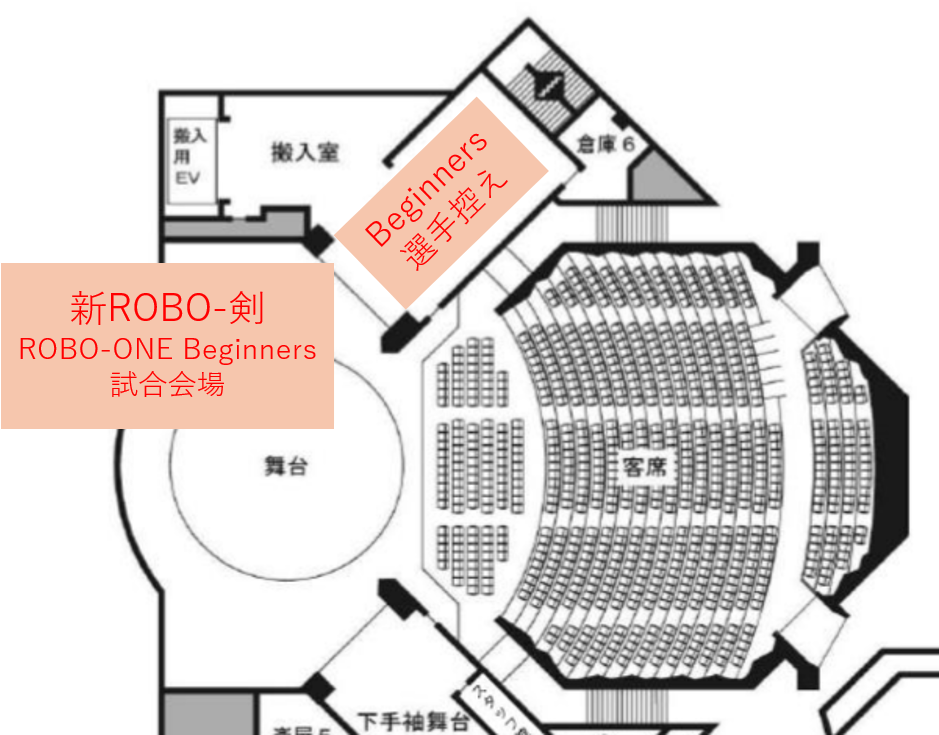
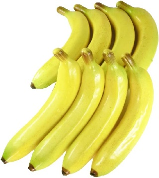

# 第8回ROBO-ONE Beginners参加者ガイド

## ＜参加者ガイドについて＞
このガイドでは、当イベントの参加手順をご紹介したガイダンスです。運営上必要な内容を含めていますので、必ずよくお読みになってご参加ください。また、このガイドは参加証と一緒に印刷して会場に持参していただきますようご協力をお願いします。


## ＜会場入場＞
### 受付
- 日時 2026年11月29日（日）
- 場所 神奈川県青少年センターホール
 9：00より試合会場への入場が可能です。選手待機場所(ホールステージ横)にてロボットの準備をお願いします。準備ができればリングを使った練習が可能です。
試合会場はステージです。下図の選手控えのエリアです。




### レギュレーションチェック
- 9:30よりレギュレーションチェックを行います。
番号シールを貼ってレギュレーションチェックを終了となります。

#### 1).バッテリーチェック
今回は、危険防止のためレギュレーションチェック時にバッテリーチェックを行います。確認する項目は下記の通りです。
```
・本体に異常がいないか　
・本体のフィルムにショートするほどの亀裂がないか　
・ケーブルの被膜のはがれや亀裂が入っていないか　
・コネクタが外れかけていないか
```
その他事故につながる危険性があるバッテリーは使用できません。

#### 2).段位認定クラス確認
レギュレーションチェック時に認定クラスを確認します。

級/段位認定については以下をご確認ください。今大会は1級までの認定を行います。飛び級ありです。キャスター間の長さとアームスポンジの色が異なります。寸法と色を確認してください。アームスポンジは参加者にてご準備ください。

https://github.com/nishibra/ROBO-ONE_Beginners/blob/main/shodan.md

また、同じ級で2度優勝したロボットは申請の有無にかかわらず昇級し、その後は新しい級での出場となります。

#### 3).出場順番号シール貼り

出場順に番号シールを貼ります。前回のシールなどははがしてください。番号シールは事務局にて準備します。


### _新ROBO-剣_/ROBO-ONE Beginners 開催スケジュール
#### 11月29日(日)
9:00 準備開始/選手入場

9:30 選手受付(兼)参加資格審査

選手受付/参加資格審査後はリングにて練習可

9:45 予告配信

10:00 オープニング

10:10 Beginnersリング周回タイムトライアル

小リングを外周に沿って1分以内に1周できること。障害物としてペットボトル、カラーコーンを置きます。これは3回まで挑戦できます。

_10:30 ROBO-剣決勝トーナメント第一回戦_

_試合前にプレゼンテーション各ロボット1分程度でお願いします。面、小手、胴、突きの発声確認をしますのでご準備ください。_

11:30 操縦体験

Beginnersのロボットで、リング中央に置いたカプセルを1分以内に自分のコーナーに運ぶことでおもちゃ入りカプセルをゲットできます。ダメな場合はお菓子やカードをプレゼント。
一般観戦者により体験操縦を行いますが、参加者が少ない場合はBeginners参加者も参加できます

12:00 休憩

13:00 Beginners決勝トーナメント(ベスト8)

_13:20 ROBO-剣決勝トーナメント(best8)_

13:40操縦体験

一般観戦者により体験操縦を行いますが、Beginners参加者も参加できます。(ペットボトルを倒したらお菓子をゲットできます。自律型も操縦可)

14:10 Beginners決勝トーナメント(決勝まで)

_14:40 ROBO-剣決勝トーナメント(決勝まで)_

15:00 体験操縦

バナナを自分のコーナーに運んでお菓子やカプセルをもらおう。競技です。
プラスチックのバナナを使用します。1個のサイズは20cm×4cm,重量20gです。



_15:30 ROBO-剣　収穫競技　実験大会__

_特別エキシビション！ 「バナナ収穫競技 実験大会」を開催いたします！
青コーナーから出発して、バナナを1分間で何個、青コーナーに運べるかを競う競技です。
得点は、バナナ1個につき1点とします。点数が同じ場合は同点となるまでの時間で順位を決定いたします。自律制御で収穫できた場合は2点、ハンドで持ち上げて移動できた場合は2点、さらに自律制御かつハンドで持ち上げて収穫した場合は、ボーナスで4点となります！_

15:50 表彰式

16:10 写真撮影終了

16:30 終了
